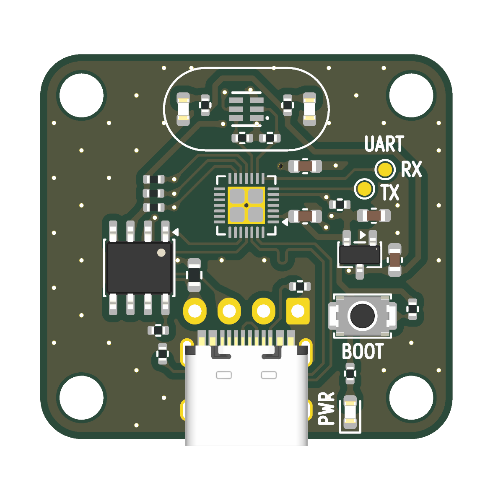
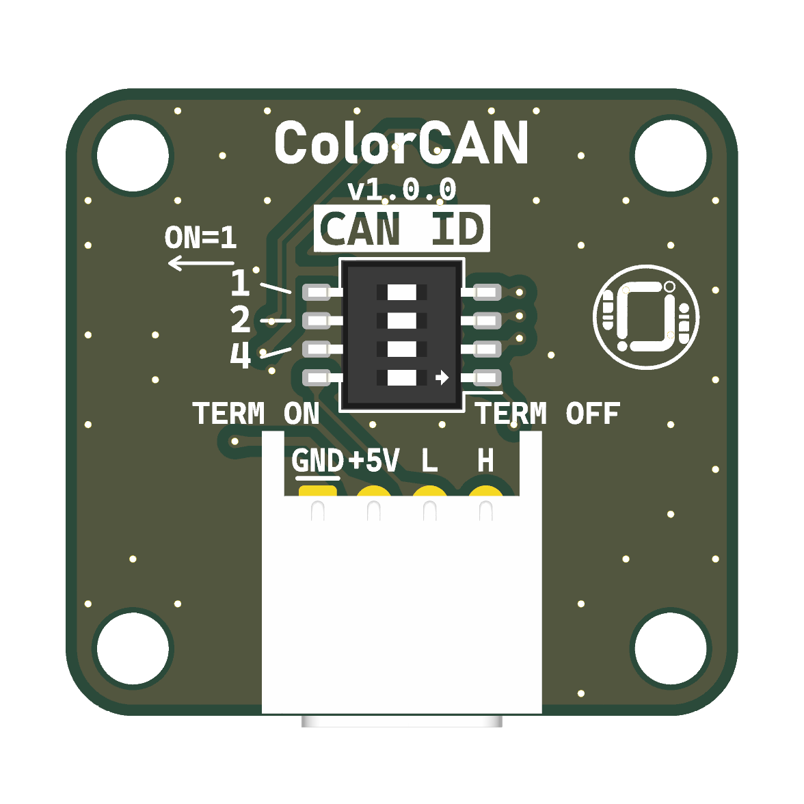
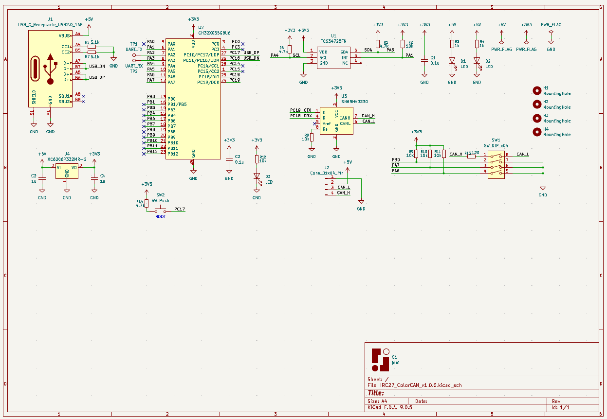
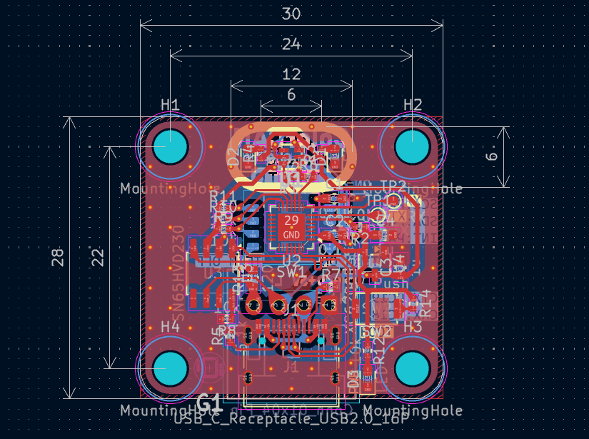

# ColorCAN

TCS34725FNで測定した赤・緑・青・Clearの値を、Classic CANで送るカラーセンサ基板です。基板シルクは **v1.0.0**、CANのハートビートで通知するプロトコル版は **1** です。




基板の配置図はKiCadの3D表示です。この表示ではカラーセンサとマイコンの実装位置がパッドで見えます。DIPスイッチの操作方向は、基板のシルクにある `ON=1` と `TERM ON` を参照してください。

## 動作の様子


## 基板仕様

| 項目 | 仕様 |
|---|---|
| 外形・取付穴 | 30 × 28 mm、四隅に直径3.2 mmのM3用取付穴。穴の中心間隔は横24 mm × 縦22 mm |
| マイコン | WCH CH32X035G8U6、QFN-28 |
| カラーセンサ | ams OSRAM TCS34725FN。I²Cの7-bitアドレスは `0x29`。試験FWは積分時間50.4 ms、ゲイン1倍 |
| 照明・電源表示 | センサ両側の白色LED 2個、電源表示の赤色LED 1個 |
| 電源 | 5 V入力。XC6206P332MR-Gで基板内の3.3 Vを生成 |
| USB-C（J1） | 5 V給電、USB ISP書き込み、仮想COMでのデバッグ |
| CAN（J2） | JST XA 4極、2.5 mmピッチ、横型（S04B-XASK-1）。SN65HVD230使用、Rsは10 kΩでGNDへ接続 |
| DIP（SW1） | [OTAX KHS42E（秋月電子・108929）](https://akizukidenshi.com/catalog/g/g108929/)、4連。3連でノード番号、1連で120 ΩのCAN終端を設定 |

## 配線とDIP設定

**DIP面を手前にして、XAコネクタを下**に向けたとき、J2のピンは左から次の順です。

| ピン | シルク | 信号 |
|---:|---|---|
| 1 | `GND` | 電源・CAN共通GND |
| 2 | `+5V` | 5 V電源入力 |
| 3 | `L` | CAN_L |
| 4 | `H` | CAN_H |

**USB-CのVBUSとJ2の+5Vは基板上で同じネットです。給電元は片方にしてください。** USB給電でCANを試す場合は、J2のGND・CAN_L・CAN_Hを接続し、J2の+5Vを開放します。J2給電中にUSBデバッグする場合は、VBUSを切ったデータ用USBケーブルを使用します。

XAコネクタを下にした状態で、**左に倒すとON、右に倒すとOFF**です。上の3段で送信するCAN IDを選び、変更後に電源を入れ直します。

| 最上段（基板の `1`） | 2段目（`2`） | 3段目（`4`） | ノード番号 | RGBCのCAN ID | ハートビートのCAN ID |
|---|---|---|---:|---|---|
| OFF | OFF | OFF | 0 | `0x240` | `0x248` |
| ON | OFF | OFF | 1 | `0x241` | `0x249` |
| OFF | ON | OFF | 2 | `0x242` | `0x24A` |
| OFF | OFF | ON | 4 | `0x244` | `0x24C` |
| ON | OFF | ON | 5 | `0x245` | `0x24D` |

一番下の `TERM` は120 Ω終端のスイッチです。CANバスの両端でONにします。

KHS42Eを取り付ける場合は、本体の `ON` 印字を左、本体の `1` をXAコネクタ側に向けます。[KHS42Eの向きが分かる商品写真](https://akizukidenshi.com/img/goods/3/108929.jpg)

## CANを受信する

**1 Mbps、Classic CAN、標準11-bit ID、データ長8バイト。** 複数バイトの数値は下位バイトから並びます。

| フレーム | 送信タイミング |
|---|---|
| RGBC | 有効な測定値を取得できたとき、100 msごと |
| ハートビート | 約1秒ごと、またはセンサ状態が変化したとき |

1. ColorCAN 1台と、1 MbpsのCAN受信機1台を短い配線でつなぎます。CAN_H同士、CAN_L同士、GND同士を接続し、両端を120 Ωで終端します。
2. 受信機を通常モード（ACKあり）に設定します。まずID用DIPをすべてOFFにしてColorCANを起動すると、ノード番号は `0` です。
3. USB-CANアダプターなどの受信ツールで、`0x240` のRGBCと `0x248` のハートビートを確認します。

### CANメッセージの例

ID用DIPをすべてOFFにしたときの例です。

```text
CAN ID  DLC  データ（16進）
0x240     8  AB 00 B5 00 B8 00 14 02
0x248     8  01 01 0B 00 61 04 00 00
```

- **`0x240` RGBC** — 2バイトずつ読むと、R = 171、G = 181、B = 184、Clear = 532。
- **`0x248` ハートビート** — プロトコル版1、測定有効、測定成功11回、起動から1,121 ms。

このFWは**ColorCAN 1台が送信するベンチ試験用**です。CH32X035のTIM1とDMAで送信と信号の読み返しを行います。複数の送信ノードが共存する運用バスに組み込むには、CANの調停、再送、エラー処理を備えた実装が必要です。ベンチ試験ではノード0の両フレームを受信確認済みです。

- [CAN仕様とデコード例](docs/CAN.md)
- [CANデータベース（DBC、ノード0〜7）](docs/ColorCAN.dbc)

## ファームウェアの書き込み

[書き込み用HEX（colorcan_can_bench.hex）](firmware/colorcan_can_bench.hex) は、ColorCAN v1.0.0の実機で使っているCH32X035G8U6向けCAN試験FWです。

1. J2からの給電を外し、基板の `BOOT` を押しながらUSB-CをPCに接続します。
2. [wchisp](https://github.com/ch32-rs/wchisp) を使い、`wchisp --usb info` でチップが `CH32X035G8U6` と表示されることを確認します。
3. HEXをダウンロードしたフォルダで次のコマンドを実行し、`Verify OK` を確認します。

```sh
wchisp --usb flash colorcan_can_bench.hex
```

書き込み後にUSBを挿し直す場合は、`BOOT` を押さずに接続すると通常起動します。

- SHA-256 `e5137b95454fce0f72337260dc35df75672d55e5464d6f02d0543154b2a608ff`
- [FWに含まれるch32funのライセンス](firmware/ch32fun-LICENSE.txt)

## USBデバッグ

- 通常起動すると仮想COMポートにRGBCを約500 msごと、CAN送信の集計を約1秒ごとに出力します。COMポートの設定例は `115200` です。
- ログの `ACK` は送信中に確認したACKの件数、`NACK` はACKなし、`BUSY` は送信前にバスが空いていなかった回数、`ERR` は読み返し不一致やDMAエラーなどです。

## 基板内の信号

| 機能 | CH32X035側 | 接続先 |
|---|---|---|
| I²C | PA4（SCL）、PA5（SDA） | TCS34725FN。各信号を4.7 kΩで3.3 Vへプルアップ |
| センサ割り込み | PA1 | TCS34725FNのINTに接続。試験FWはI²Cポーリングで測定 |
| CAN | PC19（TX）、PC18（RX） | SN65HVD230のD、R |
| USB | PC16（D−）、PC17（D+） | USB-C。BOOTボタンはPC17側に接続 |
| UARTテストパッド | PA2（TX）、PA3（RX） | TP1、TP2 |

## 回路図・基板寸法図

編集用の[KiCad 9プロジェクト](kicad/)も公開しています。リポジトリをダウンロードし、`kicad/IRC27_ColorCAN_v1.0.0.kicad_pro` を開いてください。KiCadの標準ライブラリと、同梱のプロジェクト専用ライブラリを使います。

| ファイル | 内容 |
|---|---|
| [IRC27_ColorCAN_v1.0.0.kicad_pro](kicad/IRC27_ColorCAN_v1.0.0.kicad_pro) | プロジェクトと設計ルール |
| [IRC27_ColorCAN_v1.0.0.kicad_sch](kicad/IRC27_ColorCAN_v1.0.0.kicad_sch) | 回路図 |
| [IRC27_ColorCAN_v1.0.0.kicad_pcb](kicad/IRC27_ColorCAN_v1.0.0.kicad_pcb) | 基板レイアウト |

KiCadの3D表示はインストール済みのモデルを使います。USB-CとXAコネクタの個別モデルは手元のKiCadで追加できます。外観の確認にはREADME冒頭の3D画像も使えます。

### 回路図

[](images/schematic.png)

### 基板寸法図

寸法の単位はmmです。基板外形は横30 × 縦28、取付穴の中心間隔は横24 × 縦22です。

[](images/board-dimensions.png)

## 部品資料

- [WCH CH32X035](https://github.com/openwch/ch32x035)
- [ams OSRAM TCS3472データシート](https://look.ams-osram.com/m/7ec5bcc3e40679be/original/TCS3472-DS000390.pdf)
- [TI SN65HVD230データシート](https://www.ti.com/lit/ds/symlink/sn65hvd230.pdf)
- [OTAX KHSシリーズ](https://www.otax.co.jp/service/khs/)
